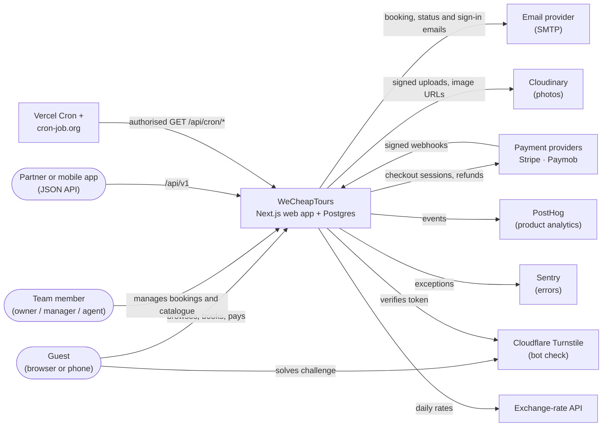
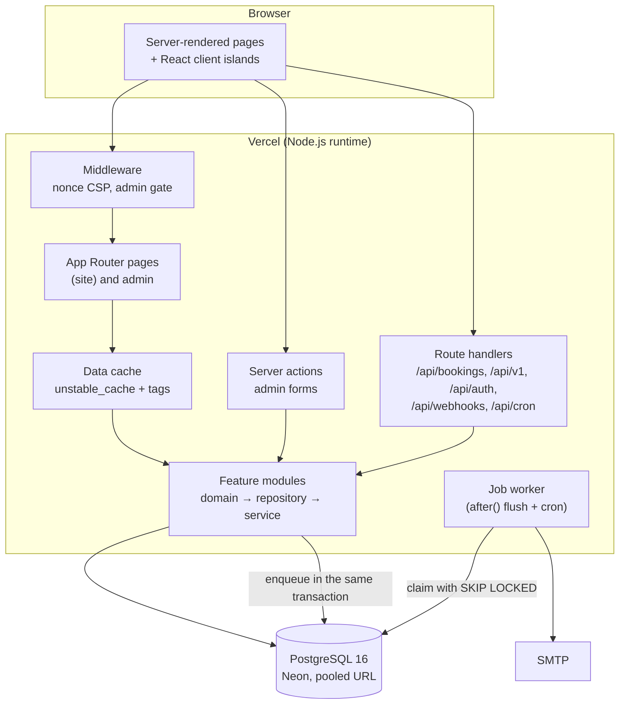
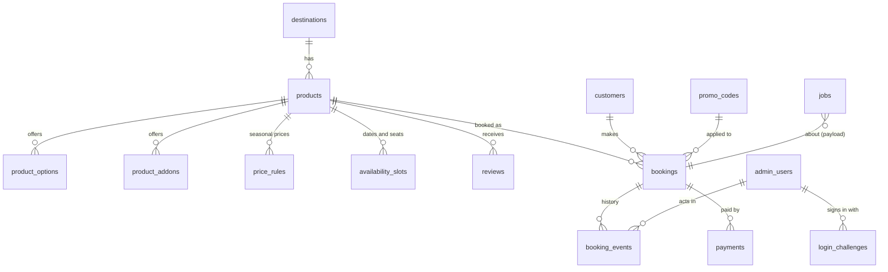

# WeCheapTours architecture

How the system is put together, and why. The decisions behind it are recorded as ADRs in
[`docs/adr`](adr/README.md). The public JSON API is described in [`docs/api/openapi.yaml`](api/openapi.yaml).

To run it on your machine and test it by hand, see [LOCAL_SETUP_AND_TEST_PLAN.md](LOCAL_SETUP_AND_TEST_PLAN.md).

## 1. What it does

WeCheapTours sells day trips, Nile cruises, airport transfers, stays and packages in Egypt and Jordan.

- **Guests** browse and search the catalogue, request a booking (no payment up front), follow it on a
  private booking page, pay a deposit or balance online when the team confirms it, and can cancel.
- **The team** (owner, managers, agents) signs in to `/admin` with a password and an emailed one-time code.
  They confirm or decline requests, manage products, prices, availability, promo codes, reviews and enquiries,
  and record payments and refunds.

## 2. System context (C4 level 1)



## 3. Containers (C4 level 2)



| Container      | Technology                                     | Responsibility                                                                                                                             |
| -------------- | ---------------------------------------------- | ------------------------------------------------------------------------------------------------------------------------------------------ |
| Web app        | Next.js 15 App Router, React 19, Tailwind 4    | Public site, checkout, guest booking page, admin panel, JSON API, webhooks, cron endpoints                                                 |
| Middleware     | Next.js middleware (edge)                      | Per-request CSP nonce, redirects unauthenticated `/admin/*` requests to the sign-in page                                                   |
| Database       | PostgreSQL 16 (Neon in production)             | All state: catalogue, availability, bookings, payments, admin users, sign-in challenges, rate limits, the job queue                        |
| Job queue      | `jobs` table + worker in `src/server/jobs`     | Emails and other side effects, written in the same transaction as the change that causes them ([ADR 0003](adr/0003-postgres-job-queue.md)) |
| Scheduled work | `vercel.json` crons + an external cron trigger | `/api/cron/run-jobs`, `/api/cron/daily` (expire requests, reminders, exchange rates), `/api/cron/weekly`                                   |
| Email          | Nodemailer over SMTP, React Email templates    | Booking received/status/reminder/review emails, enquiry emails, sign-in codes, failed-login alerts                                         |

## 4. Code structure (C4 level 3)

```
src/
  app/                    Routes only: pages, layouts, route handlers. Thin; they call feature services.
    (site)/               Public site
    admin/                Admin panel (login + (panel) behind the session)
    api/                  JSON endpoints, webhooks, cron
  features/<area>/        One folder per business area
    domain/               Pure rules: no I/O, 100% test coverage enforced (pricing, booking status, policies)
    server/               *.repository.ts (Drizzle queries), *.service.ts (use cases), *.actions.ts (server actions), emails, jobs
    components/           React components for that area
    emails/               React Email templates
    <area>.schema.ts      Zod input schemas shared by forms, API and services
  server/                 Cross-cutting: db, cache, email transport, job queue, logger, errors, security (CSP, rate limit, Turnstile, cron auth)
  config/env.ts           Validated environment (Zod); the only place that reads process.env
  i18n/                   Locale negotiation and message loading (next-intl)
  lib/                    Framework-free helpers (money, dates, routes, SEO)
messages/en.json          Interface text for the public site
drizzle/                  SQL migrations (generated from src/server/db/schema)
e2e/                      Playwright end-to-end and accessibility tests
tests/integration/        Service tests against a real Postgres
```

Import rules are enforced by ESLint ([ADR 0001](adr/0001-feature-modules.md)):

- `app/` may import a feature's `server/` services and `components/`, never its repositories.
- Only repositories and `src/server/**` touch the database.
- `domain/` code imports nothing with side effects: no database, no `fetch`, no environment.
- Only `src/config/env.ts` reads `process.env`.

Areas: `availability`, `booking`, `catalog`, `customer`, `destination`, `enquiry`, `identity`, `newsletter`,
`payment`, `promotion`, `reporting`, `review`, `settings`.

## 5. Key flows

### 5.1 Booking request

```mermaid
sequenceDiagram
  autonumber
  actor G as Guest
  participant P as Product page (BookingPanel)
  participant Q as POST /api/v1/quote
  participant B as POST /api/bookings
  participant S as booking.service
  participant DB as Postgres
  participant W as Job worker
  participant M as SMTP

  G->>P: choose option, date, guests, extras
  P->>Q: price the selection
  Q->>S: priceSelection() → quote() (pure)
  S-->>P: lines, total, deposit
  G->>B: checkout form + idempotency key + Turnstile token
  B->>B: rate limit, honeypot, Turnstile, same-origin
  B->>S: createBooking()
  S->>DB: BEGIN; lock slot; insert booking + history; enqueue "booking.received"; COMMIT
  S-->>B: booking (repeat of the same key returns the same booking)
  B-->>G: redirect to /booking/{ref}?t={hmac}
  B--)W: after(): flush jobs
  W->>DB: claim job (FOR UPDATE SKIP LOCKED)
  W->>M: guest confirmation + team alert
```

The price is always computed on the server with the same `quote()` the panel previews, so the browser can't
choose its own price. Seats are reserved inside the transaction, with the availability slot row locked.

### 5.2 Confirmation and payment

1. A team member opens the booking in `/admin/bookings/{id}` and moves it to **Confirmed**. The state machine in
   `booking/domain/booking-status.ts` allows only valid moves (for example, a cancelled booking can't be confirmed).
2. The status change, a history row and a `booking.status` email job are written in one transaction.
3. The email links to the booking page, which shows **Pay deposit** or **Pay balance** when a payment provider
   is configured.
4. The guest pays on Stripe Checkout or Paymob Unified Checkout. The provider calls
   `/api/webhooks/{stripe|paymob}`. The signature is verified and the payment is recorded once (unique by provider
   reference), which updates `paidCents`.
5. Refunds started in the admin go through the provider that took the payment.

### 5.3 Admin sign-in

1. Email + password (bcrypt). Rate limited per IP and per account.
2. A 6-digit code is emailed. Only an HMAC of it is stored in `login_challenges`. Codes expire after 10 minutes
   and allow 5 attempts.
3. On success, a session JWT is set in an HttpOnly cookie. It carries the user's `sessionVersion`, so changing a
   password or "sign out everywhere" revokes all sessions.
4. "Trust this device" sets a signed cookie that skips step 2 on that browser for 30 days.
5. Roles: **owner** (everything, including users and settings), **manager** (products, reviews, bookings, exports),
   **agent** (bookings and enquiries only). Checked in `identity/server/permissions.ts` for every page and action.

## 6. Cross-cutting concerns

| Concern          | How                                                                                                                                                                                                   |
| ---------------- | ----------------------------------------------------------------------------------------------------------------------------------------------------------------------------------------------------- |
| Security headers | Nonce-based CSP per request in middleware; HSTS, `X-Frame-Options: DENY`, `nosniff` and others in `next.config.ts` ([ADR 0004](adr/0004-nonce-csp-dynamic-rendering.md))                              |
| Rendering        | Every page renders per request (the CSP nonce needs it). Data reads go through `unstable_cache` with tags, invalidated by admin writes (`src/server/cache.ts`)                                        |
| Guest access     | No guest accounts. The booking page URL carries an HMAC of the reference ([ADR 0006](adr/0006-hmac-booking-links.md)). "Find my booking" opens it from the reference plus the booking's email         |
| Money            | Integer cents everywhere; bookings stored in USD; display currencies converted with daily rates ([ADR 0005](adr/0005-money-in-cents.md))                                                              |
| Abuse            | Postgres-backed rate limits, Turnstile on public forms (when configured), honeypot field, same-origin check on JSON posts                                                                             |
| Validation       | Zod schemas in `<area>.schema.ts`, shared by forms, API routes and services                                                                                                                           |
| Errors           | `AppError` subclasses (`ValidationError`, `NotFoundError`, `RateLimitError`…) become JSON `{ error, code }` with the right status; anything else goes to Sentry                                       |
| Logging          | pino, JSON in production, one child logger per request with a request id                                                                                                                              |
| Translations     | next-intl, English only for now, no locale in URLs yet ([ADR 0007](adr/0007-translations.md))                                                                                                         |
| Analytics        | PostHog capture API without the SDK: no cookies, an anonymous id in localStorage, no personal data in events. Vercel Web Analytics for page views                                                     |
| Migrations       | SQL files in `drizzle/` generated from the schema, applied by `npm run db:migrate` during `vercel-build`. CI fails if the schema changed without a migration ([ADR 0008](adr/0008-sql-migrations.md)) |

## 7. Data model (main tables)



Bookings copy what they need at booking time (product title, option name, add-ons, guest tier labels, prices), so
later catalogue edits never change a past booking.

## 8. Testing

| Layer                 | Tool                       | Where                                          | Runs in CI  |
| --------------------- | -------------------------- | ---------------------------------------------- | ----------- |
| Domain rules          | Vitest, 100% coverage gate | `src/features/*/domain/*.test.ts`              | `check` job |
| Units with I/O mocked | Vitest                     | `src/**/*.test.ts(x)` (emails, providers, OTP) | `check` job |
| Services + SQL        | Vitest + real Postgres     | `tests/integration/*.int.test.ts`              | `check` job |
| Whole journeys        | Playwright (Chromium)      | `e2e/booking.spec.ts`, `e2e/smoke.spec.ts`     | `e2e` job   |
| Accessibility         | axe-core (WCAG 2.1 AA)     | `e2e/a11y.spec.ts`                             | `e2e` job   |

## 9. Deployment

- **Vercel Hobby plan.** `vercel-build` runs migrations, then `next build`. Cron jobs run at most once a day on Hobby,
  so an external scheduler (cron-job.org) calls `/api/cron/run-jobs` every few minutes with the `CRON_SECRET`
  bearer token. Jobs are also flushed right after each request with `after()`, so emails normally go out at once.
- **Neon Postgres.** The app uses the pooled URL (`-pooler` host). Migrations and other schema tools use the direct
  URL, derived automatically.
- **Configuration** is validated at build and start (`src/config/env.ts`). A production build fails without
  `SMTP_HOST` and `CRON_SECRET`, or with half of a provider's settings.
